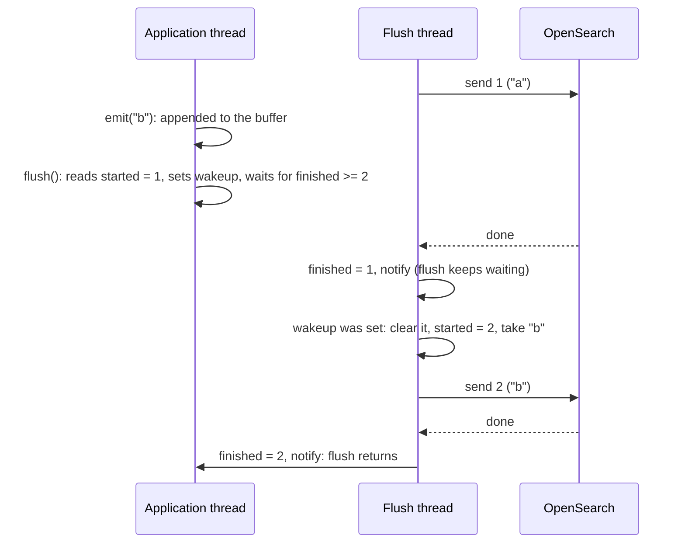
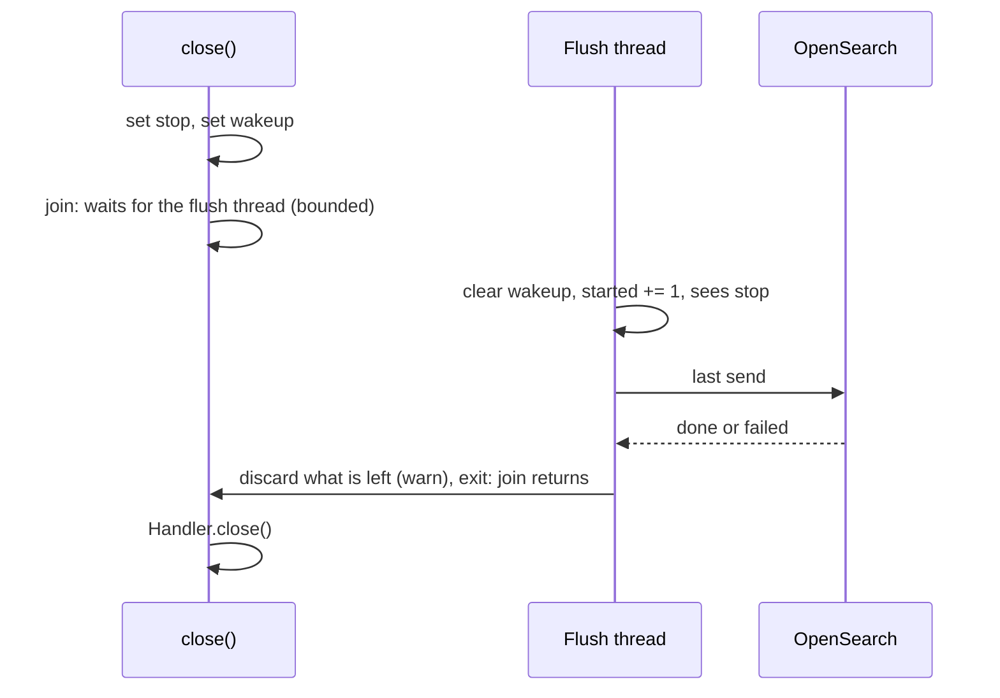

# Log handler concurrency

`OpensearchLogHandler` (`src/opensearch_client/log_handler.py`) never talks to
OpenSearch from the thread that logs. Logging a record only puts it in a buffer.
A background thread, the flush thread, sends the buffer. This page explains how
the two sides work together, while comments in the code point to its sections.

## Threads

- An application that uses the handler logs records from its own threads. For
  each record, the handler's `emit` only formats it and adds it to the buffer.
  Logging therefore never waits for the network.
- The flush thread is the only one that sends to OpenSearch.
- Any thread can call `flush` or `close`. `logging.shutdown` calls both when the
  program exits.

## Shared state and the lock

The threads share a few values, and one lock, `_lock`, protects all of them:

- `_buffer`: the records waiting to be sent. It holds at most `buffer_limit`;
  adding one more drops the oldest.
- `_overflowed`: how many records were dropped that way since the last warning.
- `_sends_started` and `_sends_finished`: how many sends have started and
  finished. `flush` uses them to know when it can return.

`_send_finished` looks like a second lock, but it is not: it is a `Condition`
built on `_lock`. It only lets `flush` sleep until the flush thread says a send
finished.

The lock is only held for a moment at a time, never during a send. To send, the
flush thread swaps the buffer for an empty one under the lock, then sends the
old one without it. So a slow cluster never makes logging wait.

## Events

Two events tell the flush thread what to do:

- `_flush_thread_wakeup`: "send now". The flush thread sleeps until it is set,
  or until `flush_interval` passes. It is set when the buffer reaches
  `flush_threshold`, by `flush`, and by `close`.
- `_flush_thread_stop`: "stop". Set by `close`. The flush thread sends one last
  time and exits.

A full buffer wakes the flush thread once, when it reaches the threshold, not
again for every record after that. This matters when the cluster is down: the
records from a failed send stay in the buffer, so it can stay over the
threshold. Waking up for every new record would resend straight away to a
cluster that just failed. Instead, the next try waits for the interval or a
`flush`.

## Starting a send

At the start of each send, the flush thread clears the wakeup and counts the
send as started, in one step under the lock. `flush` sets the wakeup and reads
the count in one step under the same lock. So a request to send can never be
missed: if it came before the send started, that send handles it; if it came
after, the wakeup is still set and the next send starts right away.

## Waiting for a flush

When `flush` returns, every record logged before it was called has been sent.

The catch is a send that is already running. It took the buffer before the
latest records were logged, so they are not part of it, and waiting for it is
not enough. So `flush` waits for the next send instead, the first one to start
after `flush` was called. That send takes the buffer, latest records included.

The two counters say which send that is. `flush` notes how many sends have
started so far, wakes the flush thread, and waits until one more send than that
has finished.

The example below shows a send running when `flush` is called.

`flush` gives up after a while (see its docstring), so the program can still
exit when OpenSearch is unreachable.

## Closing

`close` asks the flush thread to stop, wakes it, and waits for it to finish, up
to a time limit (see `close`'s docstring). The flush thread makes one last send,
drops anything still left, and exits.

The flush thread checks for "stop" only after clearing the wakeup. `close` sets
"stop" before the wakeup, so the send that `close` triggers always sees it, and
it is the last one.

Once `close` has been called, records logged later are ignored.

## Lost records

A record can be lost when:

- the buffer is full, and the oldest record is dropped
- the cluster rejects it
- a send fails with an exception
- it is still waiting when the handler closes

Each time, the flush thread logs a warning through the module's logger,
`opensearch_client.log_handler`, so the loss shows up in the application's other
handlers, such as stdout. The handler ignores records from its own thread, so
these warnings never end up in its buffer. `emit` never logs warnings itself: it
runs on the application's thread, so its warnings would come straight back to
the handler.
