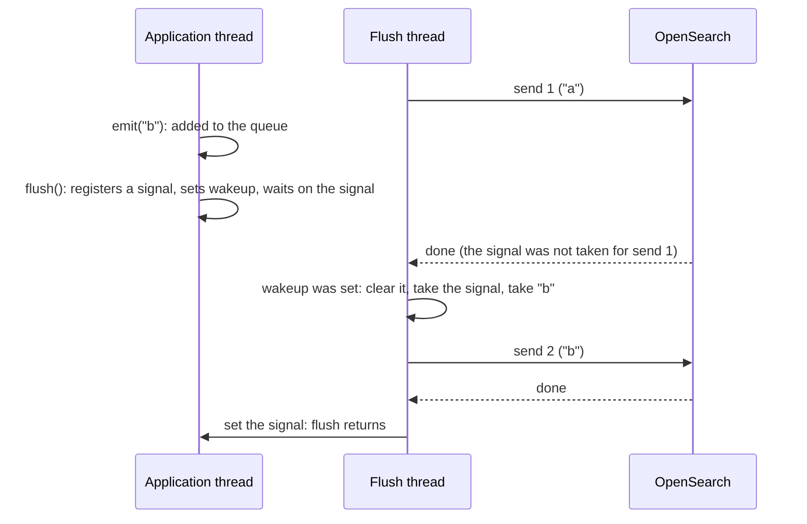
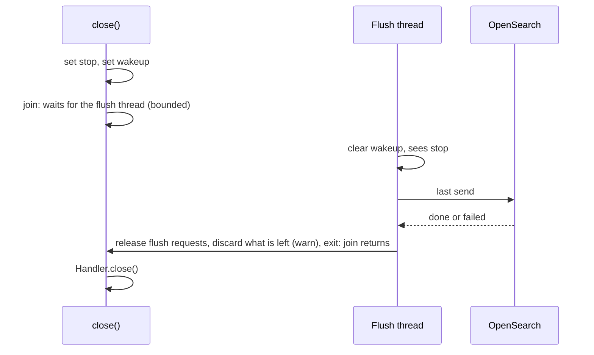

# Log handler concurrency

`OpensearchLogHandler` (`src/opensearch_client/log_handler.py`) never talks to
OpenSearch from the thread that logs. Logging a record only puts it in a buffer.
A background thread (the "flush" thread) sends the buffer.

This page explains the concurrency mental model, and comments in the code point
to its sections.

## Threads

- **Client code**: An application that uses the handler logs records from its
  own threads, each of which may access the handler simultaneously. These
  threads may call the handler's `emit` or `flush` functions.
  - Note: `logging.shutdown` calls both functions when the program exits.
- The **flush thread** is the only thread that communicates with OpenSearch.

## Shared state

The threads share two objects, each internally thread-safe:

- `_queue` (`_BoundedQueue`): the records waiting to be sent. It holds at most
  `buffer_limit`; adding one more drops the oldest. The drop count is tracked.
- `_flush_requests` (`_Waitlist`): a list of `Event` objects returned by `flush`
  and used by the `flush` thread to signal that a flush attempt has been made.

Locks are never held during a send, so a slow cluster never makes logging wait.

## Inter-thread communication

### Flush thread life-cycle

Two events manage the flush thread life-cycle:

- `_flush_thread_wakeup`: "send now". The flush thread sleeps until it is set,
  or until `flush_interval` passes. It is set when the buffer reaches
  `flush_threshold`, by `flush`, and by `close`.
- `_flush_thread_stop`: "stop". Set by `close`. The flush thread sends one last
  time and exits.

A full buffer wakes the flush thread once when it reaches the threshold. The
thread is not woken again for every new record after that. This matters when the
cluster is down: the records from a failed send stay in the buffer, so it can
stay over the threshold. Waking up for every new record would resend straight
away to a cluster that just failed. Instead, the next try waits for the interval
or a `flush`.

### Flush clients

Multiple client threads may request a flush simultaneously, so the flush
function and flush thread must communicate in a safe manner.

Client threads call `flush` to request all queued records to be sent to
OpenSearch immediately. `flush` guarantees that, on its return, a send has been
attempted for every record that was enqueued before the call OR `flush` hit its
internal timeout.

A flush runs in four steps:

1. The client calls `flush`, which registers a signal, sets
   `_flush_thread_wakeup`, and waits on the signal.
1. The flush thread wakes, clears `_flush_thread_wakeup`, and takes every
   registered signal.
1. The flush thread takes every record from `_queue` and sends them.
1. The flush thread sets the signals it took, and each waiting `flush` returns.

Step 2 comes before step 3, so the send that sets a signal holds every record
logged before its `flush` call.

A send that is already running when `flush` is called will not notify the new
caller because it gathered its list of signals before the new call. `flush`
waits for the next send instead, as in the example below.

`flush` and the flush thread access `_flush_thread_wakeup` and the waitlist in
opposite orders to prevent the following order:

- `flush` sets wakeup
- flush thread clears wakeup
- flush thread gathers waitlist
- `flush` adds itself to waitlist

In that order, the signal is not taken and the wakeup is cleared. The request
waits for the next timed send, up to `flush_interval`, and `flush` may time out
first. The flush thread taking the waitlist before clearing the wakeup would
delay a request the same way.

## Closing

`close` stops the flush thread, then closes the handler:

- `close` sets `_flush_thread_stop`, then `_flush_thread_wakeup`. It waits for
  the flush thread to exit, up to a timeout (see its docstring).
- The flush thread clears the wakeup, then checks for the stop request. It makes
  one last send, releases any remaining flush requests, and discards the records
  left in `_queue` with a warning. Then it exits.

Because of these two orderings, the send triggered by `close` always sees the
stop request, so it is the last send.

Records logged after `close` is called are ignored.

## Lost records

A record can be lost when:

- the buffer is full, and the oldest record is dropped
- the cluster rejects it
- a send fails with an exception
- it is still in the buffer when the handler closes

In each case, the flush thread logs a warning through the module's logger
(`opensearch_client.log_handler`). The warning reaches the application's other
handlers, such as stdout.

The warnings never reach this handler's buffer:

- The handler ignores records logged from the flush thread.
- `emit` never logs warnings itself. It runs on the application's thread, so its
  warnings would be sent back to the handler.
